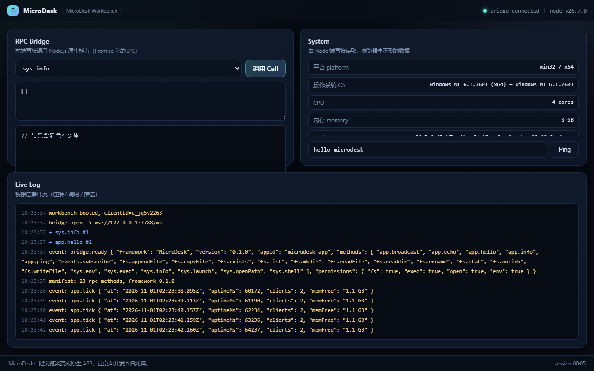

<div align="center">

# MicroDesk

**把浏览器变成原生 APP · Turn any browser into a native desktop app**

纯 Node.js · 零原生编译 · 单文件打包 · 为 Windows 7 而生

`No Electron` · `No C++` · `No Rust` · `No 100MB runtime` · `No node-gyp`

</div>



<div align="center"><sub>默认应用 Workbench：左边直接调用 Node 的任意 RPC，右边是实时系统信息，底部是桥接事件流。</sub></div>

---

> ## 硬核宣言
>
> **MicroDesk：把浏览器变成原生 APP，让桌面开发回归纯粹。**
>
> *MicroDesk: turn the browser into a native app, and let desktop development return to its essence.*

---

## 中文文档

### 它是什么

MicroDesk 是一个**桌面应用框架**，但它刻意不像 Electron：

```
Electron:  Chromium(100MB) + Node + V8 + 打包器 + 原生模块  →  ~150MB 安装包 / 200MB+ 内存
MicroDesk: 你已有的 Node.js + 用户已装的 Chrome/Edge      →  ~137KB 应用包 / 40MB 内存
```

它做三件事：

1. **Node.js 起一个本地 HTTP + WebSocket 服务**（`127.0.0.1` 随机端口），托管你的 UI，并暴露 RPC。
2. **自动找到机器上的 Chrome / Edge**，用 `--app=http://127.0.0.1:PORT` 拉起一个**没有地址栏、没有标签页、没有书签栏**的独立窗口 —— 用户看到的就是一个原生桌面程序。
3. **把浏览器的 `fetch`/WebSocket 变成 Node 的 `fs`/`child_process`**：前端一行 `await md.fs.readFile('a.txt')` 就能读磁盘。

没有 Chromium 打包、没有原生编译、没有 80MB 的 `node_modules`。整个框架**零依赖**。

### 为什么存在

| | Electron | Tauri | **MicroDesk** |
|---|---|---|---|
| 安装包体积 | ~150 MB | ~3 MB + WebView2 | **~137 KB（+ 用户已有浏览器）** |
| 需要原生编译 | 有时 | **必须**（Rust + WebView2） | **从不** |
| Windows 7 可用 | 旧版本勉强 | ❌（WebView2 不支持 Win7） | **✅ 目标平台** |
| 冷启动内存 | 200 MB+ | ~60 MB | **~40 MB** |
| 学习成本 | 高 | 高 | **会 HTML + 会 Node 就行** |
| 依赖安装 | 大 | 大 | **`git clone` 就能跑** |

### 架构

```
┌──────────────────────────── 你的应用 ────────────────────────────┐
│                                                                  │
│  ┌────────────────────┐          ┌─────────────────────────────┐ │
│  │   md_core 微内核    │  HTTP    │   Chrome / Edge  --app=     │ │
│  │  http + 手写 WS     │◄────────►│   （无地址栏的独立窗口）      │ │
│  │  静态资源 / 路由    │          │                             │ │
│  └─────────┬──────────┘          │   web/index.html            │ │
│            │                     │   web/app.js  ← 你的 UI      │ │
│  ┌─────────▼──────────┐   WS    │   web/sdk/microdesk.js      │ │
│  │  md_bridge  RPC     │◄───────►│   └─ window.MicroDesk       │ │
│  │  {id,method,params} │  JSON   └─────────────────────────────┘ │
│  │  ↓                 │                                          │
│  │  fs / sys / exec   │          ┌─────────────────────────────┐ │
│  └─────────┬──────────┘          │  md_window 探测 + 拉起       │ │
│            │                     │  注册表 / 常见路径 / PATH    │ │
│  ┌─────────▼──────────┐          │  spawn(--app=... --user-    │ │
│  │   Node.js 运行时    │          │         data-dir=...)       │ │
│  └────────────────────┘          └─────────────────────────────┘ │
│                                                                  │
│  md_pack: 整个项目 → dist/microdesk.bundle.js + 双击启动器        │
└──────────────────────────────────────────────────────────────────┘
```

### 快速开始

前置条件只有一个：**Node.js 12 或更高**（Windows 7 上推荐 Node 12/14/16 的 x64 安装包），以及**已安装的 Chrome 或 Edge**。

```bash
git clone https://github.com/<you>/micro-desk.git
cd micro-desk

# 1) 诊断：看看能不能找到浏览器
node bin/microdesk.js doctor

# 2) 启动 Demo —— 这就是那个"一条命令"的 Demo
node bin/microdesk.js start
```

执行后你会看到：

```
  MicroDesk  MicroDesk Workbench  v0.1.0
  ----------------------------------------------------
  url      http://127.0.0.1:52341/
  rpc      ws://127.0.0.1:52341/ws
  web root D:\Code\micro-desk\web
```

然后一个**没有地址栏的窗口**弹出来，里面是 MicroDesk Workbench：左边可以直接调用任意 RPC（`fs.list`、`sys.exec`、`fs.readFile`…），右边是实时系统信息和日志。

关掉窗口，服务会在 3 秒后自动退出 —— 因为 MicroDesk 知道窗口就是应用本体。

### 四个模块

| 模块 | 文件 | 职责 |
|---|---|---|
| **md_core** | `lib/core.js` | 微内核：静态托管、SPA 回退、ETag/304、`/__microdesk/health`、`/__microdesk/manifest`、优雅关闭 |
| | `lib/websocket.js` | **手写**的 RFC 6455 WebSocket 服务端（握手、分片、ping/pong、掩码、64MiB 上限）—— 为了不引入 `ws` 依赖 |
| | `lib/mime.js` | 无依赖 MIME 表 |
| **md_window** | `lib/window.js` | 探测 Chrome/Edge/Chromium（App Paths 注册表 → 协议注册表 → 常见路径 → PATH），`spawn` 注入 `--app=` / `--user-data-dir=` / `--window-size=`，无浏览器时回退系统默认浏览器 |
| **md_bridge** | `lib/bridge.js` | Promise RPC 总线：`fs.*` / `sys.*` / `app.*` 共 23 个方法、权限闸门、错误归一化、服务端主动推送 |
| | `web/sdk/microdesk.js` | 浏览器端 SDK：自动重连、超时、`EDISCONNECTED`、`md.fs.readFile()` 语法糖 |
| **md_pack** | `lib/pack.js` | 纯 JS 打包：CommonJS 模块图 → 单文件 bundle，`web/**` 以 base64 内联，生成 `.bat` / `.vbs` / `run.sh` 启动器 |

### 前后端 RPC：一行调用 Node

浏览器端（`web/sdk/microdesk.js` 已内置，也可以用 npm 后自行引入）：

```html
<script src="/sdk/microdesk.js"></script>
<script>
  const md = MicroDesk.connect();          // 连上 ws://127.0.0.1:PORT/ws

  await md.app.ping();                      // { pong: true, uptimeMs: 12 }
  const info = await md.sys.info();         // 平台 / CPU / 内存 / Node 版本
  const files = await md.fs.list('.');      // 目录列表
  await md.fs.writeFile('note.txt', 'hi');  // 写文件
  const text = await md.fs.readFile('note.txt', 'utf8');
  const out = await md.sys.exec('node', ['-v']);   // 不经过 shell，安全
  await md.sys.openPath('C:\\Windows');     // 用系统默认程序打开

  md.on('app.tick', (data) => console.log('server push', data));
</script>
```

底层协议就是一个 JSON 帧：

```jsonc
// 浏览器 → Node
{ "id": 1, "method": "fs.readFile", "params": ["package.json", "utf8"] }

// Node → 浏览器
{ "id": 1, "result": "{ \"name\": \"micro-desk\" }" }        // 成功
{ "id": 1, "error": { "code": "ENOENT", "message": "..." } } // 失败（Promise reject）
```

#### 内置方法

| 命名空间 | 方法 |
|---|---|
| `app` | `ping` `info` `echo` `hello` `broadcast`(dev) |
| `sys` | `info` `env` `exec` `shell` `launch` `openPath` |
| `fs` | `list` `readdir` `stat` `exists` `readFile` `writeFile` `appendFile` `mkdir` `unlink` `rename` `copyFile` |
| `events` | `subscribe` |

扩展只需一行：

```js
// main.js（Node 侧）
const { createBridge } = require('micro-desk/lib/bridge');
const bridge = createBridge();
bridge.define('db.query', async (sql, params) => myDatabase.query(sql, params));
```

### 打包成"双击即用"

```bash
node bin/microdesk.js pack
```

产物（`dist/`）：

```
dist/
├── microdesk.bundle.js    # 你的全部代码 + 全部 UI，单文件 137KB
├── MicroDesk.bat          # 双击启动（自动找 node.exe）
├── MicroDesk.vbs          # 双击启动，且【没有黑色控制台窗口】← 推荐
├── run.sh                 # macOS / Linux
└── pack-manifest.json     # 体积、sha256、模块数
```

把它拷到任何装了 Node（或把 `node.exe` 一起拷过去，用 `--copy-node`）的机器上，双击 `MicroDesk.vbs` —— 用户得到的体验和原生安装程序没有区别：无控制台、无地址栏、独立图标。

> **为什么不用 `pkg`？** `pkg` 需要下载预编译的 Node 二进制、对 Node 版本挑剔、生成的 30MB+ 单文件在 Windows 7 上还有签名/杀软误报问题。用**用户已有的 Node + 一个 137KB 的 bundle + 一个 .bat**，在这个场景里更可靠。想用旧版 `pkg` 也完全可以：`npx pkg dist/microdesk.bundle.js`。

### 发布到 GitHub（开源推送命令）

仓库里已经初始化好 Git，本地提交为 `feat: complete micro-desk framework`。把它推到你的账号：

```bash
# 方式一：用 GitHub CLI 一步创建公开仓库并推送
gh repo create micro-desk --public --source=. --remote=origin --push

# 方式二：手动创建空仓库后推送
git remote add origin https://github.com/<your-name>/micro-desk.git
git branch -M main
git push -u origin main
```

国内网络可选 SSH：

```bash
git remote set-url origin git@github.com:<your-name>/micro-desk.git
git push -u origin main
```

推送后建议顺手补三样：仓库 Topics（`electron-alternative` `desktop` `win7` `windows-7` `websocket` `rpc` `zero-dependencies`）、`About` 里那句硬核宣言、以及把 CI 徽章贴到 README 顶部。

### 命令行

```bash
node bin/microdesk.js start            # 起服务 + 拉起窗口
node bin/microdesk.js dev              # 开发模式：不自动退出、打印每个请求
node bin/microdesk.js doctor           # 诊断浏览器探测结果
node bin/microdesk.js pack [--out d]   # 打包
node bin/microdesk.js version
```

| 选项 | 说明 |
|---|---|
| `--port <n>` | 端口，`0` 表示由系统分配空闲端口（默认） |
| `--host <addr>` | 绑定地址（默认 `127.0.0.1`，只监听本机） |
| `--root <dir>` | 静态根目录（默认 `./web`） |
| `--browser <path>` | 强制使用某个浏览器 |
| `--width/--height` | 窗口尺寸（默认 1180×760） |
| `--kiosk` | 全屏 |
| `--no-open` | 只起服务，不开窗口（用于调试 UI） |
| `--no-auto-exit` | 最后一个窗口关闭后不退出 |
| `--dry-run` | 只打印将要执行的浏览器命令，不启动 |
| `--copy-node` | 打包时把 `node.exe` 一起拷进 `dist/` |

环境变量：`MICRODESK_BROWSER`（浏览器绝对路径）、`MICRODESK_PROFILE_DIR`（窗口数据目录根）。

### 配置文件

`microdesk.config.json` 每一个字段都可以被命令行参数覆盖：

```jsonc
{
  "app":    { "name": "MicroDesk Workbench", "id": "microdesk-app", "root": "web" },
  "server": { "host": "127.0.0.1", "port": 0 },
  "window": { "width": 1180, "height": 760, "kiosk": false, "extraArgs": [] },
  "bridge": { "permissions": { "fs": true, "exec": true, "open": true, "env": true } },
  "autoExit": true
}
```

### 安全模型（请认真读）

- 服务只监听 `127.0.0.1`，不对外网开放；**不要**改成 `0.0.0.0`。
- 窗口使用**独立的 `--user-data-dir`**（默认 `%LOCALAPPDATA%\MicroDesk\profiles\<appId>`），不污染用户日常浏览器的 cookie 和登录态。
- 静态服务做了路径穿越防护；RPC 的 `fs.*` 可以配置 `rendererRoot` 沙箱根目录；`sys.exec` **默认不走 shell**（`execFile`），`sys.shell` 才是显式的 `cmd /c`。
- `bridge.permissions` 可以逐个关掉 `fs` / `exec` / `open` / `env`，适合运行第三方 UI。
- 这不是浏览器沙箱的替代品：**你加载的页面拥有你给的权限**。只运行你信任的前端代码。

### Windows 7 实战笔记

MicroDesk 的目标平台就是 Win7（8G 内存老机器），所以专门踩过这些坑：

- **别碰原生模块**：`node-gyp` 在 Win7 上需要 VS2008/2010 或 VS2015 build tools + Python 2.7，几乎必然失败。本项目 `dependencies` 为空，`npm install` 不需要编译任何东西。
- **Node 版本**：Node 14 是支持 Win7 的最后一批官方版本之一（更高版本可能因 API 缺失无法启动）。本项目代码只用 ES2015 + `async/await` + `fs.promises`，Node 12 起可用。
- **HTTPS 站点**：老系统根证书过期会导致某些请求失败；本框架不发起任何外网请求，所有资源都走本地 HTTP，因此**不受影响**。
- **浏览器探测**：优先读 `HKLM\SOFTWARE\Microsoft\Windows\CurrentVersion\App Paths\chrome.exe`，覆盖 32/64 位与 `HKCU`；再读 `ChromeHTML`/`MSEdgeHTM` 协议注册；最后才扫 `Program Files` / `%LOCALAPPDATA%` 与 `PATH`。国产壳（360、QQ 浏览器）也在探测表里。
- **窗口体验**：`--app=` 会得到一个没有地址栏/标签栏的窗口；配合 `.vbs` 启动器隐藏控制台，双击即原生。
- **退出**：Chromium 有单实例复用，`spawn` 出来的子进程可能立刻退出，所以**不要用子进程 PID 判断窗口是否关闭**。MicroDesk 用 WebSocket 连接数判断：曾经连上过、随后归零 → 3 秒后关服务。

### 测试

无需任何测试框架：

```bash
node tests/smoke.js
```

它会启动内核，用**裸 TCP socket 实现真正的 WebSocket 客户端**，逐个验证 HTTP 层、握手、RPC、错误码、服务端推送、浏览器探测与 `--app` 参数拼装。

```
  ✓ websocket handshake (101 Switching Protocols)
  ✓ fs.writeFile  (55 bytes)
  ✓ fs.readFile roundtrip
  ✓ sys.exec exit code
  ✓ unknown method rejects with ENOMETHOD
  ✓ server pushes app.tick events
  --------------------------------------------------------
  32 passed, 0 failed
```

### 目录结构

```
micro-desk/
├── bin/microdesk.js         # CLI：start / dev / doctor / pack
├── lib/
│   ├── core.js              # md_core
│   ├── websocket.js         # 手写 WS
│   ├── mime.js
│   ├── window.js            # md_window
│   ├── bridge.js            # md_bridge
│   ├── pack.js              # md_pack
│   ├── util.js
│   └── index.js             # 编程入口
├── web/                     # 你的 UI（默认应用：Workbench）
│   ├── index.html
│   ├── app.css
│   ├── app.js
│   └── sdk/microdesk.js     # 浏览器端 SDK
├── tests/smoke.js
├── examples/hello/          # 最小示例
└── microdesk.config.json
```

### Roadmap

- [x] 微内核 + 手写 WebSocket + 静态托管
- [x] 浏览器探测与 `--app` 窗口拉起
- [x] Promise RPC（fs / sys / app）
- [x] 纯 JS 单文件打包 + 无控制台启动器
- [ ] 托盘图标（不引入原生模块的纯 JS 方案）
- [ ] 多窗口与窗口间消息路由
- [ ] 热重载开发服务器（文件变更 → 自动 reload）
- [ ] 类型定义 `.d.ts`

---

## English

### What is MicroDesk?

A desktop app framework that deliberately **does not** ship a browser.

```
Electron:  Chromium(100MB) + Node + V8 + packers + native modules  → ~150MB app, 200MB+ RAM
MicroDesk: your existing Node.js + the Chrome/Edge already installed → ~137KB app, ~40MB RAM
```

1. Node.js serves your UI on `http://127.0.0.1:<random>` and exposes an RPC bridge over WebSocket.
2. MicroDesk finds Chrome/Edge on the machine and spawns it with `--app=<url>`: a standalone window with **no address bar, no tabs, no bookmarks bar**.
3. A tiny browser SDK turns that socket into Node powers: `await md.fs.readFile('a.txt')` just works.

Zero dependencies, zero native compilation, zero `node-gyp`. The whole framework is plain JavaScript.

### Why it exists

| | Electron | Tauri | **MicroDesk** |
|---|---|---|---|
| Package size | ~150 MB | ~3 MB + WebView2 | **~137 KB** |
| Native compilation | sometimes | **required** (Rust + WebView2) | **never** |
| Runs on Windows 7 | barely | ❌ | **✅ by design** |
| Idle memory | 200 MB+ | ~60 MB | **~40 MB** |
| Learning curve | steep | steep | **HTML + Node** |

### Quick start

Requirements: **Node.js 12+** and an installed **Chrome or Edge**.

```bash
git clone https://github.com/<you>/micro-desk.git
cd micro-desk

node bin/microdesk.js doctor    # is a browser detectable?
node bin/microdesk.js start     # the one-command demo
```

A frameless window opens with the MicroDesk Workbench: run any RPC on the left (`fs.list`, `sys.exec`, …), watch live system info and the event log on the right. Close the window and the server exits automatically — the window *is* the app.

### The four modules

| Module | Files | Responsibility |
|---|---|---|
| **md_core** | `lib/core.js`, `lib/websocket.js`, `lib/mime.js` | HTTP kernel, static serving with ETag/304 and SPA fallback, health/manifest endpoints, **hand-rolled RFC 6455** server (no `ws` dependency) |
| **md_window** | `lib/window.js` | Browser discovery (App Paths registry → URL-handler registry → well-known paths → PATH) and `spawn` with `--app=`, `--user-data-dir=`, `--window-size=` |
| **md_bridge** | `lib/bridge.js`, `web/sdk/microdesk.js` | Promise RPC bus: 23 methods across `fs` / `sys` / `app`, permission gates, normalised errors, server→client push, auto-reconnect client |
| **md_pack** | `lib/pack.js` | CommonJS module graph → one bundle, `web/**` inlined as base64, `.bat` / `.vbs` / `run.sh` launchers |

### Calling Node from the page

```html
<script src="/sdk/microdesk.js"></script>
<script>
  const md = MicroDesk.connect();

  await md.app.ping();
  const files = await md.fs.list('.');
  await md.fs.writeFile('note.txt', 'hello from the page');
  const out = await md.sys.exec('node', ['-v']);   // no shell involved
  md.on('app.tick', (d) => console.log('pushed', d));
</script>
```

On the wire it is just JSON frames:

```jsonc
{ "id": 1, "method": "fs.readFile", "params": ["package.json", "utf8"] }
{ "id": 1, "result": "..." }
{ "id": 1, "error": { "code": "ENOENT", "message": "no such file or directory" } }
{ "event": "app.tick", "data": { "memFree": "1.1 GB" } }
```

Extend it in both directions — `bridge.define('db.query', handler)` on the Node side, and `md.db.query(...)` in the browser, because the client proxies namespaces with `Proxy`.

### Ship it

```bash
node bin/microdesk.js pack        # → dist/microdesk.bundle.js (137 KB) + launchers
```

Copy `dist/` anywhere with Node installed and double-click `MicroDesk.vbs`: no console window, no address bar, just your app. Add `--copy-node` to ship `node.exe` alongside it for a fully portable folder. (An old `pkg` works too: `npx pkg dist/microdesk.bundle.js`.)

### Security notes

- Binds `127.0.0.1` only — never expose it to the network.
- Uses a dedicated `--user-data-dir` per app, so the user's real browser profile is untouched.
- Path-traversal protection on static files; optional `rendererRoot` sandbox for `fs.*`; `sys.exec` runs **without a shell** by default.
- `bridge.permissions` lets you disable `fs` / `exec` / `open` / `env` entirely for untrusted UI code.
- This is not a sandbox: the page has exactly the powers you grant it. Only load front-end code you trust.

### Windows 7 notes

The target platform is a real Win7 box with 8 GB of RAM, so:

- **No native modules.** `node-gyp` on Win7 needs VS build tools + Python 2.7 and usually fails; this project has an empty dependency tree.
- **Node 14 is the practical ceiling** for Win7; the code sticks to ES2015 + `fs.promises` and runs on Node 12+.
- **No external HTTPS calls** — everything is local HTTP, so expired root certificates on an old OS cannot break it.
- **Exit detection** never trusts the browser's PID (Chromium reuses a single process): MicroDesk watches WebSocket clients — once someone connected and the count drops to zero, the server shuts down after 3 s.

### Test

```bash
node tests/smoke.js      # 32 assertions, no test framework required
```

---

## License

[MIT](./LICENSE) © MicroDesk contributors

<div align="center">

**MicroDesk：把浏览器变成原生 APP，让桌面开发回归纯粹。**

</div>
